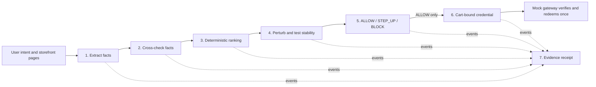

# Warrant (TRUSSTED)

Warrant is a research prototype for decision integrity in AI-assisted shopping. It sits between an agent's product choice and purchase authorization. It tests whether a selected product changes when presentation conditions change, applies an explicit deterministic policy, and can issue a short-lived credential for one exact cart. It does not establish that product information is true and it does not replace the shopping agent.

The project is a prototype and benchmark, not a production payment or fraud-prevention system. The current implementation covers **Stages 4–6 only**. Stages 1–3, Stage 7, API integration, benchmark runner, and dashboard are integration work owned elsewhere or not yet implemented in this repository.

## System workflow



Stages 1–3 provide product evidence and a ranked candidate. Stage 4 reruns the supplied extractor and ranker after controlled content and ordering changes; it does not implement another ranker. Stage 5 applies the deterministic policy to validated same-run evidence. Its evidence builder derives policy inputs from typed stage outputs and authoritative mappings; request-provided booleans are not trusted evidence.

Stage 6 verifies signed credentials at a mock gateway and supports one-time redemption. The public `issue_credential` function currently denies issuance because the contracts do not prove that a cart contains the selected product and seller. The gateway checks the signed run ID, submitted cart, merchant, amount, currency, and nonce. Its database redemption predicate compares the verified run, signature, approval hash, cart hash, merchant, amount, currency, nonce, unused state, and expiry in one update. Stage 7 is expected to consume structured events from the pipeline, but its owner and event contract are unconfirmed; this repository does not implement a receipt system.

## Stage ownership

| Stage/workstream | Owner | Responsibility |
|---|---|---|
| 1. Extraction | Mayank | Typed product facts from untrusted storefront content |
| 2. Cross-verification | Mayank | Compare facts with an independent reference and report conflicts/NoReference |
| 3. Ranking | Mayank | Deterministic intent-based ranking and stable tie-breaking |
| 4. Perturbation/stability | Priyansh | Re-run upstream extraction/ranking after controlled transformations |
| 5. Decision policy | Priyansh | Deterministic `ALLOW`, `STEP_UP`, or `BLOCK` |
| 6. Credential/mock gateway | Priyansh | Simulated cart-bound authorization and replay-safe verification |
| 7. Evidence receipt | Unconfirmed | Hash-chained, signed evidence record and offline verification |
| Database/schema | Ayush | SQLite schema, SQLAlchemy 2 models, Alembic migrations |
| API/integration | Deepika | API endpoints and orchestration of the business modules |
| Frontend | Anchal | User-facing frontend/dashboard |

The present code exposes plain typed Python boundaries for Stages 4–6. It does not assume Mayank's implementation already exists, and it does not add API or frontend code. The detailed upstream and downstream contracts are in [`docs/PIPELINE_CONTRACTS.md`](docs/PIPELINE_CONTRACTS.md).

## Current implementation status

Implemented in this branch:

- Stage 4 typed extraction/ranking interfaces, canonical typed-content hashes plus preserved source hashes, labeled persuasion stripping, seeded shuffles, callback run-ID validation, fact checks, winner drift detection, a strict structural adapter for Mayank's concrete selection output, and a `warrant.db` persistence adapter. The Mayank adapter requires explicit candidate and actual-seller mappings; Mayank's current output cannot supply those mappings or typed source blocks itself.
- Stage 5 deterministic priorities, integer minor-unit thresholds, machine-readable reason codes, exact `winner_fact_id` provenance, and a deterministic approval hash bound to the decision and evaluated evidence. The typed same-run evidence builder validates stage ownership and derives policy facts; its Python DTOs are not cryptographic attestations and must be assembled by trusted application adapters.
- Stage 6 strict cart hashing, Ed25519 JWT/JWS verification, run-bound mock gateway, and a `SharedCredentialLedger` adapter using Ayush's repositories and transaction helper. Public issuance fails closed because no approved product-to-cart proof exists. Forward-only migrations add decision winner provenance, approval hashes, and one credential per run.
- Unit/security-focused tests for the above behaviors.
- This README, [`SECURITY.md`](SECURITY.md), [`docs/PIPELINE_CONTRACTS.md`](docs/PIPELINE_CONTRACTS.md), and example environment variables.

Final correction-pass verification: full pytest **356 passed**; focused Stage 4–6/evidence-builder/adapter/persistence/concurrency suite **173 passed**; Ruff check and format check passed (100 Python files); strict mypy passed (62 source files). The full test run includes migration-backed database tests. Verification used CPython 3.12.10, SQLAlchemy 2.0.55, PyJWT 2.15.1, pytest 9.1.1, Ruff 0.17.2, and mypy 2.4.0 without changing dependency pins. The public `issue_credential` function remains disabled until exact winner-to-cart identity is proven. See [`docs/FINAL_IMPLEMENTATION_AND_SECURITY_AUDIT.md`](docs/FINAL_IMPLEMENTATION_AND_SECURITY_AUDIT.md).

Not implemented here: Stages 1–3, Deepika's API server, browser checkout, PayPal adapter, Stage 7 receipts/CLI, benchmark runner/report generator, dashboard, production deployment, or real payment processing. Ayush's canonical database package and migration-backed tests are included from the supplied archive. The API and full product workflow are not integrated. `issue_credential` is disabled because no agreed trusted mapping connects persisted winner identity and actual seller to the cart's free-standing `product_id` and merchant fields. `create_after_allow` and `store_credential` are persistence APIs; they are not authorization or issuance endpoints and must not be exposed directly as routes.

## Requirements and local setup

- Python 3.12.
- SQLite as configured by the database owner. The database specification requires foreign keys and WAL mode.
- Database dependencies are pinned to Ayush's supplied versions in `pyproject.toml`; cryptography uses `cryptography` and PyJWT's EdDSA/JWS support.

From the repository root in PowerShell:

```powershell
py -3.12 -m venv .venv
.\.venv\Scripts\Activate.ps1
python -m pip install --upgrade pip
python -m pip install -e ".[dev]"
```

If `py` is not installed, use an installed Python 3.12 executable to create the virtual environment. The repository does not currently include an application command or API server to start. Stage functions are imported by the integration layer; see the contract document for their call signatures.

Run the automated suite:

```powershell
python -m pytest
```

Run formatting/lint and static type checks:

```powershell
ruff check .
ruff format --check .
mypy --strict src
```

Tests use synthetic products and explicitly labeled test-only seller identities. Gateway unit tests use signed test-only fixtures and a test-only SQLite adapter under `tests/support`; runtime code does not use that adapter. The current suite also exercises Ayush's actual models, Alembic chain, shared credential adapter, and SQLite concurrency behavior under the pinned dependencies. The Mayank structural adapter is checked against both realistic fixtures and actual archive dataclasses. These tests do not verify a composed API workflow. The public issuer is intentionally blocked. No test needs a PayPal account or external network access.

## Configuration and keys

`.env.example` shows placeholder names only. The current modules do not load `.env` files or read these variables automatically; Deepika's application wiring must validate and pass configuration explicitly.

- `WARRANT_DATABASE_PATH`: local SQLite database path for integration wiring.
- `WARRANT_SIGNING_KEY_PATH`: encrypted Ed25519 private PEM path.
- `WARRANT_SIGNING_KEY_PASSPHRASE`: local development passphrase; supply through a protected environment mechanism, not a committed file.
- `WARRANT_SIGNING_KEY_ID`: stable key identifier placed in the JWT `kid` header.

Generate encrypted local keys without displaying private material:

```powershell
python -m warrant.credential.keygen `
  --private .\var\keys\warrant-ed25519-private.pem `
  --public .\var\keys\warrant-ed25519-public.pem `
  --key-id local-dev-1
```

The command prompts for a passphrase of at least 12 characters and refuses to overwrite either output. The private key uses encrypted PKCS#8 PEM. Keep local key files outside version control; `.gitignore` excludes PEM/key files. On Windows, additionally restrict file access through NTFS ACLs. This prototype has no HSM, cloud KMS, or automated key-rotation service.

## PayPal scope decision

The PRD lists real payment processing and real merchant integrations as non-goals, while Stage 6 describes a simulated credential and mock gateway. The separate master directive proposes a PayPal sandbox adapter. That is a scope conflict, not an already-approved requirement. This branch preserves the mock gateway and has **no PayPal adapter**. A minimal sandbox-only adapter behind a gateway interface is documented as a proposed amendment requiring separate approval. Production endpoints, live credentials, and capture are out of scope here.

Warrant and PayPal authorization are separate decisions. If issuance is enabled after the missing cart identity contract is resolved, a Warrant credential would represent approval of a specific cart and a one-time nonce; it would not be a PayPal credential. A PayPal buyer approval or order state would not prove the Warrant policy passed. If a sandbox adapter is approved, Warrant checks must be repeated before sandbox capture, and the PayPal client secret must remain server-side.

## Benchmark methodology

The PRD defines attack scenarios S1–S7 and benign scenarios B1–B5. Runs must use fixed recorded seeds and model/configuration versions. Report:

- Attack success rate (ASR), with 95% Wilson confidence intervals.
- False-block rate on benign cases and benign task success.
- p50/p95 latency overhead and LLM cost per decision.
- Perturbation instability rate on benign cases.

The PRD's falsification criterion is retained: H1 is **not supported** if, with at least 30 runs per scenario, the 95% Wilson interval for Warrant ASR overlaps baseline ASR, or benign false-block rate exceeds 15%. Report that result either way. Do not infer open-web performance from synthetic fixtures or present unmeasured improvement claims. A benchmark harness and benchmark results are not yet present in this repository.

## Limitations

1. If the extracted source and independent reference agree on the same false fact (scenario S6), these checks can pass it.
2. Extraction still uses an LLM on untrusted text. Schema constraints reduce malformed output; they do not remove prompt-injection or semantic extraction risk.
3. Perturbation tests add latency/cost and can flag legitimate close choices as unstable. The MVP requires 100% winner stability across the configured perturbations; it does not use majority voting.
4. Deterministic ranking depends on explicit user intent, which may be absent or underspecified.
5. A signed receipt would prove integrity of recorded events, not truth of their original inputs; acceptance by issuers has not been demonstrated.
6. Synthetic fixture results do not establish generalization to the open web.
7. Stage 4 removes only blocks explicitly labeled `marketing` or `review`. It does not use a heuristic classifier to decide what prose is persuasive. Unclassified material is preserved, and the upstream adapter must provide reliable block labels.
8. The mock gateway and local key handling are research-prototype controls, not production payment security.

## Source specifications

The repository now includes the supplied [`PRD.md`](PRD.md), [`ARCHITECTURE.md`](ARCHITECTURE.md), and [`DATABASE.md`](DATABASE.md) unchanged, alongside this implementation's [`SECURITY.md`](SECURITY.md) and [`docs/PIPELINE_CONTRACTS.md`](docs/PIPELINE_CONTRACTS.md). The master engineering directive remains the task-level assignment and boundary reference. Keep these source specifications synchronized through explicit team review when requirements change.
